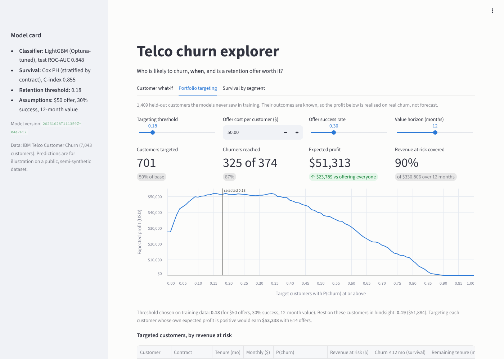
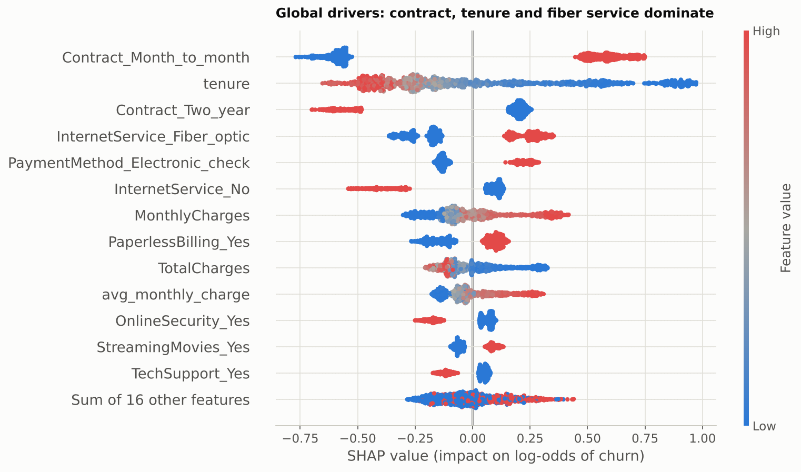
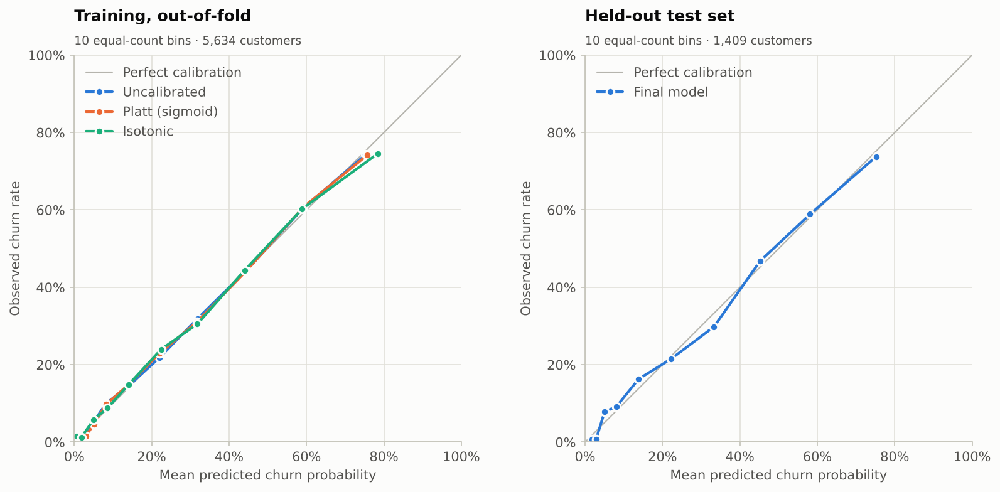
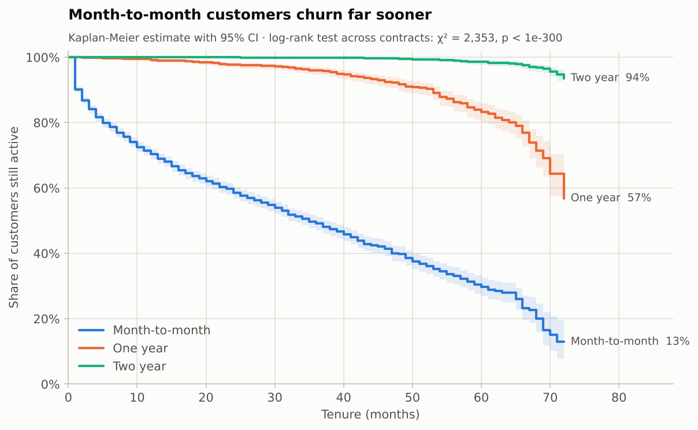
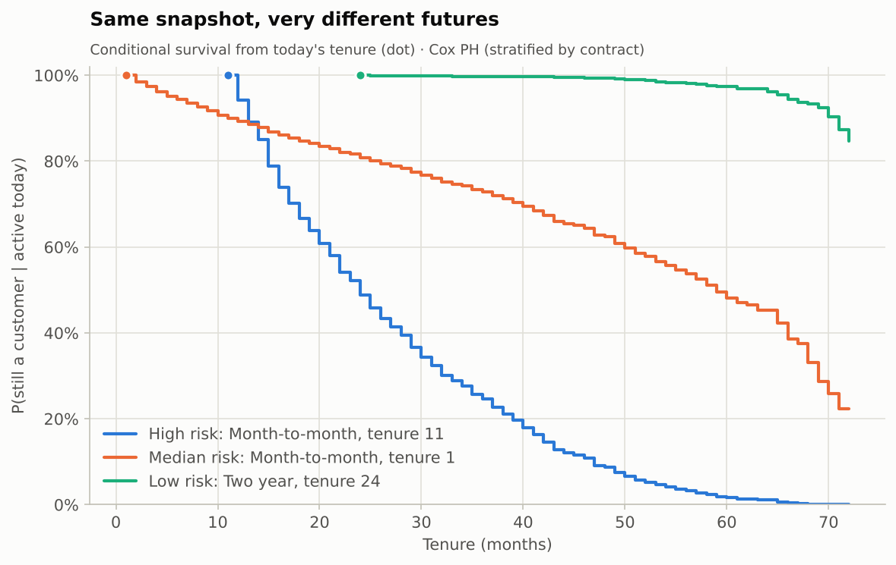
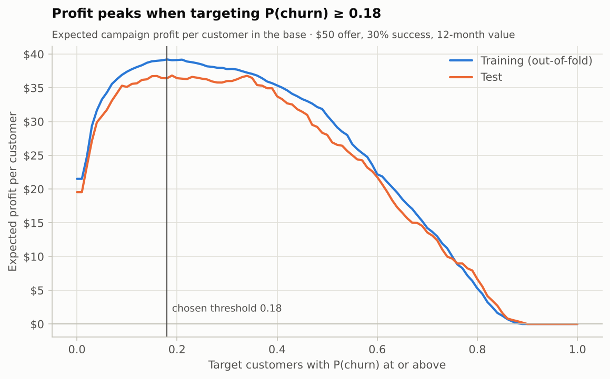
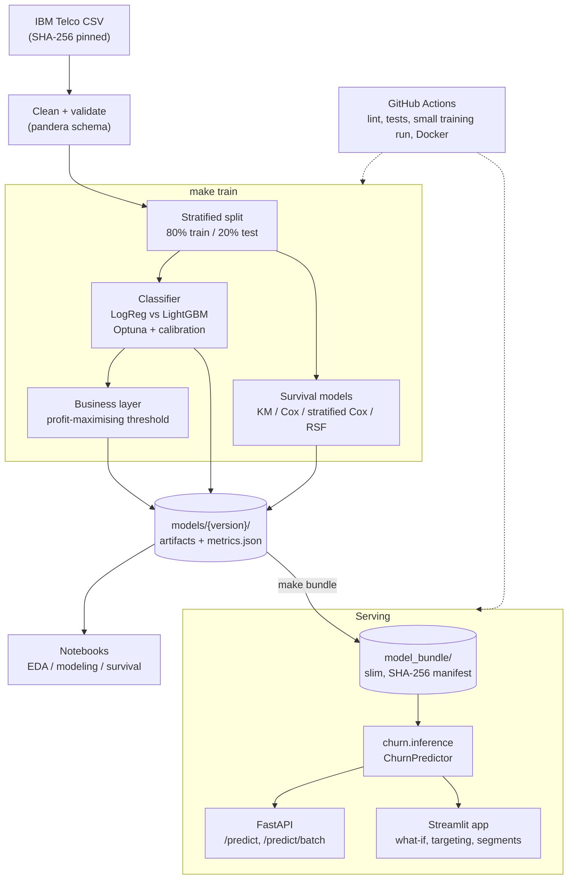
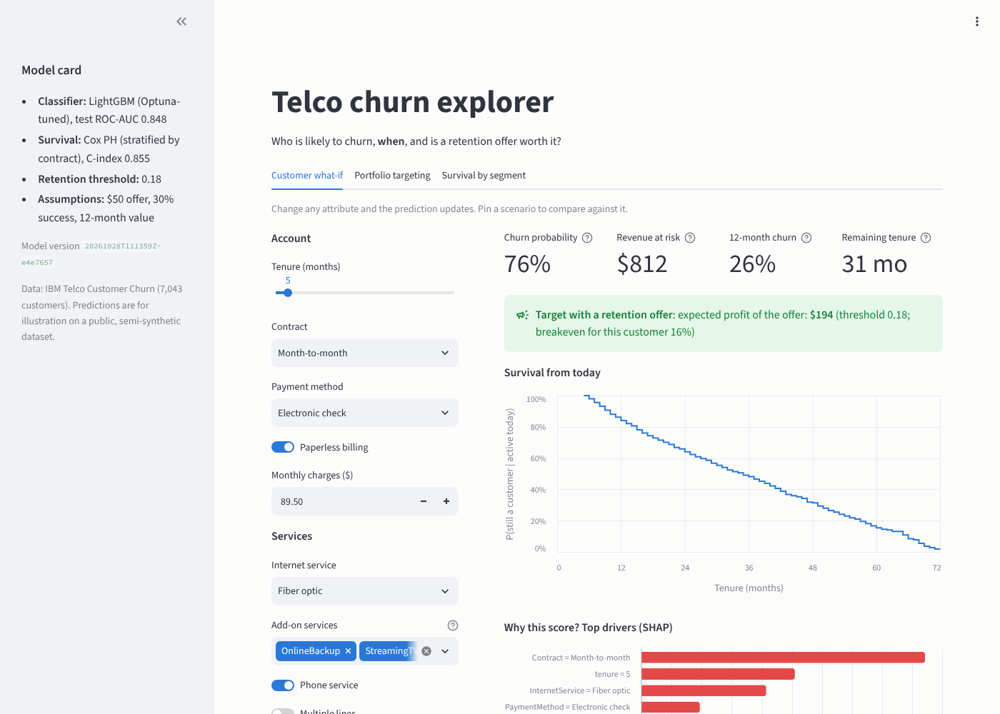

# Telco churn: who will leave, when, and is it worth keeping them?

[](https://github.com/monayerkabir/telco-churn-survival/actions/workflows/ci.yml)
[](https://www.python.org/downloads/release/python-3110/)
[](LICENSE)

An end-to-end data science case study on 7,043 telecom customers. It predicts **whether**
a customer will churn (classification), **when** they will churn (survival analysis), and
turns both into a **retention decision**: which customers are worth a retention offer. It
ships as a tested Python package, a FastAPI service, a Streamlit app, Docker images and CI.

<p align="center">
  
</p>

## Results at a glance

| Question | Answer (held-out test set, 1,409 customers) |
|---|---|
| **Will they churn?** | Tuned LightGBM: **ROC-AUC 0.848** [0.826–0.868], PR-AUC 0.666, Brier 0.135, well calibrated |
| **When?** | Cox model stratified by contract: **C-index 0.855**, integrated Brier 0.083 (55% better than no covariates) |
| **Who should get an offer?** | P(churn) ≥ 0.18: reaches **87% of churners** and earns **\$51k** expected profit, **1.9×** offering everyone |
| **Why do they churn?** | Month-to-month contracts, the first year of tenure, fiber internet, electronic-check payment |

## 1. The problem

Every churned customer takes their future revenue with them, but retention offers are not
free: a discount given to a customer who would have stayed is pure cost. A useful churn
model therefore has to answer three questions, not one:

1. **Who** is likely to churn? (ranking and calibrated probabilities)
2. **When** will they churn, and how much revenue is at stake? (time-to-event)
3. **Is it worth intervening?** (expected profit under explicit cost and success assumptions)

## 2. The data

[IBM Telco Customer Churn](https://github.com/IBM/telco-customer-churn-on-icp4d): 7,043
customers and 21 columns covering demographics, services, contract, billing and tenure. 26.5%
churned. It is a single snapshot: `tenure` is months with the company, and active customers
have not churned *yet*, so their lifetimes are **right-censored**. That is why survival
analysis is used for the "when" question.

- The download is pinned by SHA-256, and the raw data is never committed.
- Cleaning is validated by a [pandera](https://pandera.readthedocs.io) schema that checks
  types, allowed levels, ranges and cross-column consistency. For example, the 11 blank
  `TotalCharges` values belong to brand-new customers, so they become 0 rather than an
  imputed median.

## 3. Approach

| Step | What was done | Why |
|---|---|---|
| **Leakage control** | All preprocessing inside sklearn `Pipeline`s, refit in every CV fold. The 20% test set was touched once. | Honest generalisation estimates |
| **Classification** | Logistic-regression baseline vs LightGBM, stratified 5-fold CV, Optuna tuning (40 trials) | A strong, simple baseline to beat |
| **Calibration** | None / Platt / isotonic compared by out-of-fold Brier with nested CV | Probabilities feed a profit calculation |
| **Explainability** | SHAP (TreeExplainer), global and per customer, with one-hot dummies summed back to business attributes | Explanations a retention team can read |
| **Survival** | Kaplan-Meier, Cox PH, Cox PH **stratified by contract**, random survival forest. Tenure-derived covariates excluded. | Contract violates proportional hazards; tenure would leak the outcome |
| **Business layer** | Revenue at risk = P(churn) × monthly charge × 12. Threshold chosen to maximise expected profit on out-of-fold predictions. | Turn scores into a decision |
| **Reproducibility** | Seeds everywhere, deterministic LightGBM, versioned artifacts with `metrics.json` (git SHA, data checksum, library versions) | `make all` reproduces every number |

The full reasoning is in the three executed notebooks:
[01 EDA](notebooks/01_eda.ipynb) · [02 Modeling](notebooks/02_modeling.ipynb) ·
[03 Survival](notebooks/03_survival.ipynb).

## 4. Results

### Classification: will they churn?

| Model | CV ROC-AUC | CV PR-AUC | CV Brier |
|---|---|---|---|
| Logistic regression (baseline) | 0.846 ± 0.014 | 0.659 ± 0.021 | 0.135 |
| LightGBM (default) | 0.835 ± 0.009 | 0.637 ± 0.027 | 0.142 |
| **LightGBM (Optuna-tuned)** | **0.850 ± 0.013** | **0.667 ± 0.022** | **0.134** |

On the held-out test set the tuned model scores **ROC-AUC 0.848** [0.826–0.868, bootstrap 95% CI],
**PR-AUC 0.666** (no-skill: 0.265) and **Brier 0.135**. The honest finding is that tuning
beats a well-specified logistic regression by only **+0.004 ROC-AUC**. Most of the value
comes from calibrated probabilities and the decision layer, not from the choice of algorithm.
Neither Platt nor isotonic calibration improved the Brier score, so none is applied.

<table>
  <tr>
    <td width="50%"></td>
    <td width="50%"></td>
  </tr>
  <tr>
    <td><b>What drives churn:</b> month-to-month contracts, short tenure, fiber internet and electronic-check payment raise risk.</td>
    <td><b>Probabilities can be trusted:</b> predicted vs observed churn sits on the diagonal, both out-of-fold and on the test set.</td>
  </tr>
</table>

### Survival: when will they churn?

| Model | C-index ↑ | Integrated Brier ↓ |
|---|---|---|
| Kaplan-Meier (no covariates) | 0.500 | 0.183 |
| Cox PH | 0.855 | 0.084 |
| **Cox PH, stratified by contract** | **0.855** | **0.083** |
| Random survival forest | 0.845 | 0.091 |

Contract type violates the proportional-hazards assumption (the retention curves converge),
so the primary model gives each contract type its own baseline hazard. Two-year customers
churn at **0.08×** the month-to-month hazard; automatic payment roughly **halves** it, and
fiber internet raises it by **42%**.

<table>
  <tr>
    <td width="50%"></td>
    <td width="50%"></td>
  </tr>
  <tr>
    <td><b>Retention by contract:</b> only 13% of month-to-month customers are still active after six years, against 94% on two-year contracts (log-rank p &lt; 1e-300).</td>
    <td><b>Per-customer forecasts:</b> from today's tenure, the model gives each customer a survival curve, a 12-month churn probability and the expected active months.</td>
  </tr>
</table>

### Decision: who gets a retention offer?

Assumptions: a **\$50** offer, **30%** of would-be churners retained, **12 months** of revenue
saved. They live in [`config.py`](src/churn/config.py), and notebook 02 shows how the decision
changes if they do.

| Policy (held-out test set) | Customers targeted | Churners reached | Expected profit |
|---|---|---|---|
| Do nothing | 0 | 0 | \$0 |
| Offer everyone | 1,409 | 374 | \$27,524 |
| **P(churn) ≥ 0.18** (threshold chosen on training data) | **701** | **325** | **\$51,313** |
| Per-customer breakeven (value-aware) | 614 | 294 | \$53,338 |
| Best threshold in hindsight (not achievable) | – | – | \$51,884 |

<p align="center">
  
</p>

The threshold chosen on training data captures **99%** of the best achievable profit on
unseen customers. The model's own forecast from predicted probabilities (\$54k) was close to the \$51k computed from actual churn outcomes.

## 5. Business recommendation

1. **Launch a targeted retention campaign at P(churn) ≥ 0.18.** It covers about half the
   base but **87% of churners and 90% of the revenue at risk**. Under the stated
   assumptions that is about **\$36 of expected profit per customer in the base**, roughly
   **\$255k a year** if the test-set rate holds across all 7,043 customers.
2. **Act in the first year.** Churn is front-loaded (53% of customers in their first six
   months churned), so onboarding and early-tenure check-ins matter most for
   month-to-month customers.
3. **Pull the levers the models point to** (associations, to be validated as experiments):
   - move electronic-check payers to auto-pay (associated with half the hazard);
   - bundle tech support / online security for fiber customers;
   - review fiber pricing and perceived value (it raises risk despite being the premium
     product).
4. **Measure before scaling.** The 30% success rate is the least certain input. Run the
   first wave as an A/B test with a randomised hold-out, then move to the **value-aware
   rule**, which earned about \$2k more on the test set with 87 fewer offers.

## 6. Architecture



The API and the app share one scoring layer, `churn.inference.ChurnPredictor`, so the
prediction logic exists once. Both load a slim (0.34 MB) committed model bundle whose
checksums are verified at load time.

## 7. Run it

**Everything from a fresh clone** (needs Python 3.11 and internet for the data):

```bash
git clone https://github.com/monayerkabir/telco-churn-survival.git
cd telco-churn-survival
make all        # venv + pinned deps -> data -> train -> notebooks -> tests -> lint
```

**Serve the models** (uses the committed `model_bundle/`, no training needed):

```bash
make install    # once
make api        # FastAPI on http://localhost:8000 (interactive docs at /docs)
make app        # Streamlit on http://localhost:8501
```

**With Docker:**

```bash
docker compose up --build    # API on :8000, app on :8501
```

**Score a customer:**

```bash
curl -X POST "localhost:8000/predict?top_k=3" -H "content-type: application/json" \
  -d '{"gender": "Female", "SeniorCitizen": 0, "Partner": "Yes", "Dependents": "No",
       "tenure": 5, "PhoneService": "Yes", "MultipleLines": "No",
       "InternetService": "Fiber optic", "OnlineSecurity": "No", "OnlineBackup": "Yes",
       "DeviceProtection": "No", "TechSupport": "No", "StreamingTV": "Yes",
       "StreamingMovies": "No", "Contract": "Month-to-month", "PaperlessBilling": "Yes",
       "PaymentMethod": "Electronic check", "MonthlyCharges": 89.5}'
```

The response contains the churn probability, the retention decision and its expected
profit, revenue at risk, a survival summary (survival at +3/6/12/24 months, 12-month churn
risk, expected remaining tenure) and the top SHAP drivers.

**Deploy the app** to Streamlit Community Cloud: point it at `app/streamlit_app.py` with
Python 3.11. Dependencies come from `app/requirements.txt`, and the dataset is downloaded
and verified on first use.

<p align="center">
  
</p>

Other targets: `make test`, `make lint`, `make bundle` (export a new run for serving) and
`make help` for the full list.

## 8. Project structure

```
src/churn/        the package
  config.py         paths, seeds, schema, every modeling and business assumption
  data.py           download (checksum), cleaning, pandera schema, split
  features.py       leakage-safe feature engineering + preprocessing pipelines
  train.py          CV, Optuna, calibration, threshold, survival -> versioned artifacts
  survival.py       Kaplan-Meier, Cox, stratified Cox, RSF; remaining-tenure maths
  evaluate.py       metrics, bootstrap CIs, C-index, integrated Brier
  business.py       revenue at risk, expected profit, thresholds, value-aware targeting
  inference.py      ChurnPredictor: the single scoring path for API and app
  bundle.py         export + verify the deployment bundle
  plots.py          one accessible figure style for every chart
api/              FastAPI service (Pydantic schemas, lifespan model loading)
app/              Streamlit app (standalone; Streamlit Cloud ready)
notebooks/        01 EDA, 02 modeling, 03 survival (executed, with outputs)
model_bundle/     slim, checksummed models served by the API and app
reports/          figures/ and metrics.json of the reference run
docs/             model card and README images
tests/            74 offline tests: data, features, models, inference, API, app
requirements/     serve.txt (runtime pins) and dev.txt (training, notebooks, tests)
Dockerfile        api and app images; docker-compose.yml runs both
.github/          CI: lint, tests, small training run, Docker build + smoke test
```

## 9. Limitations and next steps

**Limitations** (more detail in the [model card](docs/model_card.md)):

- The dataset is **semi-synthetic** and a **single snapshot**. Covariates are measured at
  the end rather than at sign-up, and the "left within the last month" label implies earlier
  churners are missing. Absolute survival levels are therefore optimistic; rankings are more
  robust.
- The classifier (snapshot label) and the survival model (churn within 12 months) answer
  **different questions**. They rank customers consistently (Spearman 0.77) but give
  different probabilities.
- Drivers are **associations, not causes**. Contract length partly reflects intent to stay.
- The profit numbers depend on **assumed** offer cost and success rate.
- Nothing is observed beyond **72 months**, so lifetime value beyond six years is not
  estimated.

**Next steps:**

- **Uplift modeling.** Target customers the offer *changes* (persuadables), not just
  high-risk ones, using data from a randomised campaign.
- **Time-varying covariates** and a parametric survival model (e.g. Weibull AFT) to
  extrapolate customer lifetime value beyond the observation window.
- **Monitoring:** calibration per segment, input drift, and realised offer success, feeding
  scheduled retraining. Senior citizens are the first group to watch.
- **Deployment:** publish the app on Streamlit Community Cloud and the API image to a
  registry.

## Documentation

- [Model card](docs/model_card.md): intended use, data, metrics with confidence intervals,
  subgroup performance, limitations, monitoring
- Notebooks: [01 EDA](notebooks/01_eda.ipynb) · [02 Modeling](notebooks/02_modeling.ipynb) ·
  [03 Survival](notebooks/03_survival.ipynb)
- API reference: run `make api` and open http://localhost:8000/docs

## License

[MIT](LICENSE). Data: IBM Telco Customer Churn sample, used for illustration.
